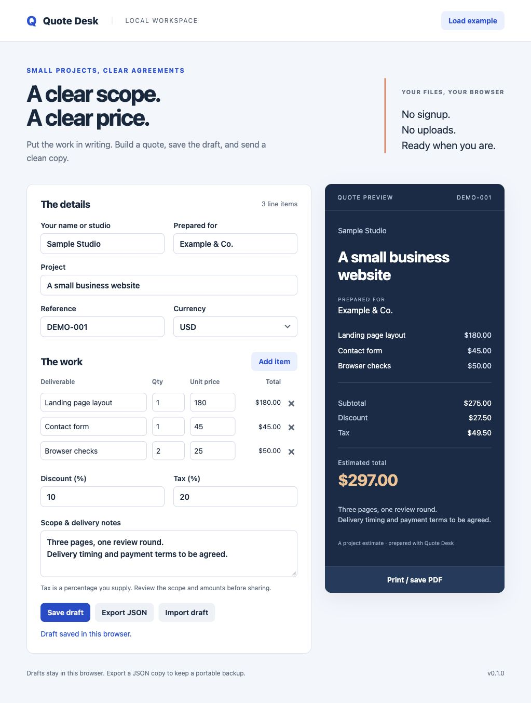

# Quote Desk

A small browser app for putting a project scope and price into a clean, printable quote. No account, third-party scripts, build step, or remote API.



## Start locally

```sh
python3 -m http.server 8751 --bind 127.0.0.1
```

Open <http://127.0.0.1:8751>. Serve the folder over HTTP; opening `index.html` directly may block ES module imports in your browser.

## Included

- Editable deliverables, quantities and unit prices.
- USD, EUR and UAH display; no currency conversion.
- Discount before tax, with explicit half-up rounding at each step.
- Integer-based calculations: quantities allow three decimals, prices and percentages two.
- Local browser draft storage and validated JSON import/export.
- A print stylesheet for printing or using the browser's Save as PDF.
- A synthetic example to try without entering client information.

Use **Load example** to inspect the full flow. The sample subtotal is $275.00; after a 10% discount and 20% tax, the total is $297.00. It is a demonstration, not a client testimonial or a recommended tax rate.

Drafts saved in browser storage stay on that origin. Private mode, clearing site data, or changing the local port may make them unavailable. Export JSON for a portable backup. Imports replace the current in-memory draft; they are not automatically saved. No data is transmitted by the app.

This is a project-estimate tool. It does not implement jurisdiction-specific invoice rules, tax advice, accounting, payment collection or legally validated document templates. Review the scope, numbers and terms before sending a quote.

## Development

```sh
node --test money.test.js
```

No package installation is needed. `money.js` contains the calculation and import validation logic; `app.js` handles the browser interface. Text entered by the user is rendered as text, not HTML.

Checks cover exact decimal arithmetic, fractional quantities, half-up rounding, discount/tax order, invalid values and draft validation. Browser checks cover sample loading, line edits, local save/reload and a narrow viewport.

The `release/v0.1` branch is the first working handoff snapshot.

## License

MIT. See [LICENSE](LICENSE).
